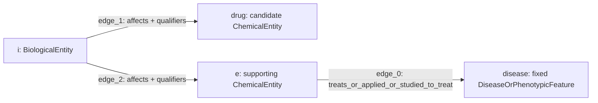

# ARAGORN treatment rule evaluation across environments

On **19 October 2026**, we evaluated how hosted ARAGORN expands and executes its 18 treatment-inference rules across **Development, CI/Staging, Test, and Production**. The experiment compared the submitted queries, observed rule expansions, retrieval outcomes, and final merged chemical answers.

The main finding was that **all environments expanded the same 18 rules and returned the same raw callback counts and outcome classifications**. However, Development returned additional final chemical answers for four targets, indicating a difference beyond the observed raw counts.

On **20 October 2026**, a controlled follow-up examined why rules 12, 13, and 16 were empty. For pheochromocytoma, all three remained empty in CI/Staging, Test, and Production, but removing their qualifiers produced **27,984 raw result records in each environment**. A known-edge control also demonstrated qualifier enforcement. For this target, the evidence points to available paths failing the rules' specific effect conditions; Development's version-related warning does not explain these empty searches. The follow-up methods, evidence, and limits are described below.

## Consolidated findings through 22 October 2026

ARAGORN expanded all eighteen treatment rules in the original forty-query experiment. Seven rules returned raw paths for at least one target; eight were rejected; three were empty for all ten targets. The follow-ups identify different reasons for these outcomes rather than a single expansion failure.

| Rules | What the follow-ups establish | What remains unresolved |
|---|---|---|
| 1 | Retriever rejects `affects_response_to`, although the term exists in official Biolink 4.3.2, the version advertised by Production. | Actual validator model/loading or validation behavior; no confirmed replacement. |
| 2 | `similar_to` retrieves gene/protein orthology through predicate expansion in four public environments. The full downloaded similarity-family scan found no chemically typed endpoints. | No chemical witness exists in the checked data for a positive category-inheritance test; other releases and source modeling remain untested. |
| 3, 4, 5, 7, 8 | `genetic_association` is retrievable across nine tested category patterns in four public environments. The required Gene-to-condition pattern remains unsupported in the checked evidence. | Semantic suitability of alternative predicates and recovery of complete adapted rules. |
| 9 | `has_output` is a valid model term, but neither it nor `is_output_of` appears in the checked metadata/local inventory. Category relaxation did not resolve the rejection. | Why the data is absent or modeled differently; no positive witness. |
| 12, 13, 16 | Required annotations exist on Gene/Protein objects in the downloaded graph, but no matching records have the required ChemicalEntity object. Real witnesses returned in public Development/Test/Production. | CI remained empty even without qualifiers; subclass-join behavior and source modeling remain unresolved. Full-rule recovery is untested. |

The positive category-witness checks succeeded in **36/36 genetic-association lookups** and **16/16 similarity lookups**. The latter returned `orthologous_to` edges, not edges stored literally as `similar_to`. These counts are separate from the main forty-query ARAGORN experiment.

Three distinctions are essential: **model validity is not graph coverage; predicate expansion does not remove endpoint-category requirements; successful raw retrieval is not proof of contribution to ARAGORN's final answers.**

The main run was recorded between **23:48:05 and 23:55:45 UTC**. It contained **40 original queries: ten targets submitted to four environments**. Four preliminary logging probes were retained separately and excluded from the main comparison. The main comparison is saved as `output/run_002`; the preliminary probes are in `output/run_001`.

**Each submitted question asked which chemicals treat one fixed disease or phenotype.** The chemical node was unpinned, and the treatment edge was marked `knowledge_type: inferred`.

```text
ChemicalEntity —[biolink:treats, inferred]→ fixed DiseaseOrPhenotypicFeature
```

The ten targets were:

| Query | Target | Submitted identifier |
| --- | --- | --- |
| q01 | pheochromocytoma | `MONDO:0008233` |
| q02 | cafe au lait spots, multiple | `MONDO:0007245` |
| q03 | biotinidase deficiency | `MONDO:0009665` |
| q04 | Fever | `HP:0001945` |
| q05 | Halitosis | `HP:0100812` |
| q06 | COVID-19 | `MONDO:0100096` |
| q07 | osteoarthritis, hand | `MONDO:0006632` |
| q08 | liver carcinoma | `MONDO:0007256` |
| q09 | mycosis fungoides | `MONDO:0009691` |
| q10 | Endotoxemia | `UMLS:C0376618` |

Seven targets came from our earlier rule probes. The remaining three were the next distinct targets in the existing seeded treatment-holdout cohort. This was an exploratory convenience sample, rather than a representative sample of all treatment queries.

The following is the **exact request body submitted to Development for q01**:

```json
{
  "message": {
    "query_graph": {
      "nodes": {
        "drug": {
          "categories": [
            "biolink:ChemicalEntity"
          ]
        },
        "disease": {
          "categories": [
            "biolink:DiseaseOrPhenotypicFeature"
          ],
          "ids": [
            "MONDO:0008233"
          ]
        }
      },
      "edges": {
        "e": {
          "subject": "drug",
          "object": "disease",
          "predicates": [
            "biolink:treats"
          ],
          "knowledge_type": "inferred"
        }
      }
    }
  },
  "workflow": [
    {
      "id": "aragorn.lookup"
    }
  ],
  "parameters": {
    "tier": 0,
    "tiers": [
      0
    ],
    "tier_fallback": false,
    "timeout": 120,
    "log_level": "DEBUG",
    "bypass_cache": true
  },
  "submitter": "aragorn-ten-target-environment-comparison"
}
```

For the other targets, we changed the identifier in `disease.ids`. For the older TRAPI 1.x environments, we additionally supplied `"log_level": "DEBUG"` at the top level because those ARAGORN releases read logging configuration there. The query graph, workflow, and retrieval parameters were otherwise unchanged.

The settings requested:

- **`aragorn.lookup` workflow:** expansion, retrieval, filtering, and merging.
- **Tier 0**, with tier fallback disabled.
- **120-second lookup timeout.**
- **DEBUG logging** and cache bypass.
- Subclass behavior left at the service defaults.

Existing treatment edges remained available. This experiment therefore evaluated retrieval and inference with existing evidence present; it was not a treatment-edge holdout experiment. Scoring and ranking were outside the selected workflow.

**The environment was selected through the destination URL.** A Python script on our machine submitted HTTP POST requests to the hosted services:

| Environment | ARAGORN query endpoint | Advertised application / TRAPI / Biolink |
| --- | --- | --- |
| Development | `https://shepherd.renci.org/aragorn/query` | 2.0.2 / 2.0.0 / 4.4.4 |
| CI/Staging | `https://shepherd.ci.transltr.io/aragorn/query` | 1.3.0 / 1.6.0 / 4.1.6 |
| Test | `https://shepherd.test.transltr.io/aragorn/query` | 1.1.7 / 1.5.0 / 4.1.6 |
| Production | `https://shepherd.transltr.io/aragorn/query` | 1.1.7 / 1.5.0 / 4.1.6 |

These versions were captured from the services’ OpenAPI documents during the experiment. They describe the advertised interfaces and releases; they do not independently verify deployed container image digests.

The runtime logs showed the following retrieval destinations:

| ARAGORN environment | Observed retrieval URL |
| --- | --- |
| Development | `http://retriever/asyncquery` |
| CI/Staging | `https://retriever.ci.transltr.io/asyncquery` |
| Test | `https://retriever.test.transltr.io/asyncquery` |
| Production | `https://retriever.transltr.io/asyncquery` |

Development’s `http://retriever` is an internal hostname within its hosted deployment. Our machine contacted ARAGORN; it did not contact that internal hostname directly.

**We submitted only the original one-edge inferred query. ARAGORN generated the expanded lookups internally.**

For each original question, ARAGORN generated:

1. A **direct lookup**, searching for the original treatment relationship using the retrieval service’s matching semantics.
2. **18 rule lookups**, each searching for the supporting graph pattern described by one treatment-inference template.

The execution sequence was:

```text
Our machine submits one original inferred treatment query
    → hosted ARAGORN expands the query
    → direct lookup + 18 rule lookups are sent to Retriever
    → retrieval callbacks return
    → ARAGORN filters and merges the results
    → the final response is returned to our machine
```

A rule lookup can contain several edges and intermediate nodes. Some rules also require existing treatment relationships as part of their supporting pattern.

The 40 main queries therefore produced **760 observed callbacks**:

```text
40 direct-lookup callbacks
+ 40 × 18 rule callbacks
= 760 callbacks
```

**We identified individual rules from their logged query graphs, rather than from callback order or result counts.**

For each environment, we saved the rule file associated with its advertised release:

```text
workers/aragorn_lookup/rules_with_types_cleaned_finalized.json
```

The treatment rules were read under:

```text
{"predicate": "biolink:treats"}
```

Rule numbers refer to their positions in that saved list.

The identification procedure was:

1. Instantiate each release template with the submitted target identifier and the query’s node names.
2. Read the expanded query graph recorded in each callback’s DEBUG log.
3. Compare the observed graph with the expected template, preserving node categories, pinned identifiers, edge directions, predicates, and qualifiers.
4. Use the callback ID to associate the identified rule with its result count and warnings or errors.

The comparison normalized JSON key ordering and known TRAPI qualifier-format differences. Older templates use `qualifier_constraints`, while Development uses `constraints.qualifiers`. This normalization was for offline comparison only; we did not rewrite or submit the expanded queries ourselves.

The expected graphs were therefore **reference patterns for identifying observed callbacks**, not additional service requests. An unmatched graph would remain unidentified.

**The returned logs provide separate evidence for expansion, rejection, and results.** Each entry contains a timestamp, severity level, and message. The bracketed callback ID connects entries belonging to the same lookup, even when messages from different lookups are interleaved.

For example, the following entries are copied directly from the Development q01 response. Our graph comparison identified callback `e25ad198` as **rule 6**:

```json
{
  "message": "[e25ad198] Sending lookup query to http://retriever/asyncquery",
  "timestamp": "2026-10-19T23:48:06.069836+00:00",
  "level": "INFO"
}
```

```json
{
  "message": "[e25ad198] Got back 411 results, 298 nodes and 569 edges.",
  "timestamp": "2026-10-19T23:48:06.763463+00:00",
  "level": "INFO"
}
```

The associated DEBUG message contained a graph with these three edges:

```text
drug ──treats_or_applied_or_studied_to_treat──→ disease
drug ──treats_or_applied_or_studied_to_treat──→ h
h    ──has_phenotype────────────────────────→ disease
```

Here, `drug` was a ChemicalEntity, `h` was a Disease, and `disease` was the pinned DiseaseOrPhenotypicFeature. That structure matched rule 6.

The classification was therefore: **expansion observed; positive raw callback with 411 results**. It does not imply 411 unique final chemical answers.

A different callback, identified as **rule 1**, showed an explicit invalid-predicate rejection:

```json
{
  "level": "ERROR",
  "message": "[155d80da] Validation Error: Edge `edge_0` has invalid predicates: ['biolink:affects_response_to']",
  "timestamp": "2026-10-19T23:48:06.101+00:00"
}
```

Its subsequent callback reported:

```json
{
  "message": "[155d80da] Got back 0 results, 0 nodes and 0 edges.",
  "timestamp": "2026-10-19T23:48:06.150917+00:00",
  "level": "INFO"
}
```

Although the count was zero, this was classified as **rejected**, not as a successful empty search.

For **rule 3**, the service reported an unsupported edge pattern:

```json
{
  "level": "WARNING",
  "message": "[cfa96bc4] MetaEdges could not be found for the following QEdge(s): ['edge_1']",
  "timestamp": "2026-10-19T23:48:06.080+00:00"
}
```

The full associated query-graph log was:

```json
{
  "message": "[cfa96bc4] for query graph: {'nodes': {'drug': {'categories': ['biolink:ChemicalEntity']}, 'disease': {'ids': ['MONDO:0008233'], 'categories': ['biolink:DiseaseOrPhenotypicFeature']}, 'h': {'categories': ['biolink:Gene']}}, 'edges': {'edge_0': {'predicates': ['biolink:treats_or_applied_or_studied_to_treat'], 'subject': 'drug', 'object': 'disease'}, 'edge_1': {'predicates': ['biolink:genetic_association'], 'subject': 'h', 'object': 'disease'}, 'edge_2': {'predicates': ['biolink:interacts_with'], 'subject': 'drug', 'object': 'h'}}}",
  "timestamp": "2026-10-19T23:48:06.138614+00:00",
  "level": "DEBUG"
}
```

Reading the warning and query graph together identifies the unsupported pattern as:

```text
Gene ──biolink:genetic_association──→ DiseaseOrPhenotypicFeature
```

The log **does not call `genetic_association` an invalid predicate**. It reports that no compatible MetaEdge was found for this typed query edge.

**Why rules 12, 13, and 16 are “empty,” while the other eight rules are “rejected.”**

A zero-result callback alone does not distinguish these outcomes. We first identify the rule from its logged query graph, then inspect the callback's warnings, errors and traversal messages. A missing MetaEdge or invalid predicate takes precedence over the zero count: it is classified as a rejection. “Empty” requires an identified zero-result callback without a logged rejection, error or incomplete-search indication. Nonfatal warnings are retained separately; this label does not guarantee full qualifier enforcement.

The excerpts below are from the **same Development q01 query**, targeting pheochromocytoma (`MONDO:0008233`). Messages are copied verbatim, with their log levels displayed before them; intervening lines are omitted. Bracketed IDs identify the callbacks matched to each rule.

For **rule 3**, the service rejected a required typed pattern before graph traversal:

```text
WARNING [cfa96bc4] MetaEdges could not be found for the following QEdge(s): ['edge_1']
INFO [cfa96bc4] Got back 0 results, 0 nodes and 0 edges.
```

The rejected `edge_1` is `Gene → genetic_association → DiseaseOrPhenotypicFeature`. This is a supported-pattern check: it does not establish that the predicate is globally invalid or absent from every graph record. Rule 1 is a separate rejection type: its predicate fails validation.

For **rules 12, 13, and 16**, the logs show that graph traversal actually started. All three use a supporting chemical `e` connected to the disease by `treats_or_applied_or_studied_to_treat`, and a BiologicalEntity `i` connected to both that chemical and the candidate drug by qualified `affects` edges. Their requested qualifier conditions differ:

| Rule | Requested aspect on both `affects` edges | Requested direction |
| --- | --- | --- |
| 12 | `metabolic_processing` | `decreased` |
| 13 | `transport` | `decreased` |
| 16 | `secretion` | `increased` |

**Exact requested edges of the three rules.** The following table is extracted from the saved callback query graphs. Subject → object is the requested edge direction; a backward search through the graph does not reverse that direction. Qualifier columns name the requested `biolink:object_aspect_qualifier` and `biolink:object_direction_qualifier` values. “—” means no qualifier was requested on that edge.

The query variables mean:

| Variable | Node category | Role |
| --- | --- | --- |
| `drug` | `biolink:ChemicalEntity` | Open candidate chemical whose treatment relationship is being inferred |
| `e` | `biolink:ChemicalEntity` | Supporting chemical with a treatment-related edge to the target |
| `i` | `biolink:BiologicalEntity` | Shared biological entity required to affect both chemicals |
| `disease` | `biolink:DiseaseOrPhenotypicFeature` | Fixed target; `MONDO:0008233` in the displayed q01 example |

All three rules request this structure; the qualifier values on both `affects` edges distinguish the rules:



| Rule | Edge | Subject | Predicate | Object | Requested aspect | Requested direction | Observed Development q01 traversal |
| --- | --- | --- | --- | --- | --- | --- | --- |
| 12 | `edge_0` | `e` (biolink:ChemicalEntity) | `biolink:treats_or_applied_or_studied_to_treat` | `disease` (biolink:DiseaseOrPhenotypicFeature) | — | — | 629 matching edges at this traversal step |
| 12 | `edge_1` | `i` (biolink:BiologicalEntity) | `biolink:affects` | `drug` (biolink:ChemicalEntity) | metabolic_processing | decreased | Not reached in this traversal; no match count established |
| 12 | `edge_2` | `i` (biolink:BiologicalEntity) | `biolink:affects` | `e` (biolink:ChemicalEntity) | metabolic_processing | decreased | 0 matching edges for the current partial matches; traversal stopped |
| 13 | `edge_0` | `e` (biolink:ChemicalEntity) | `biolink:treats_or_applied_or_studied_to_treat` | `disease` (biolink:DiseaseOrPhenotypicFeature) | — | — | 629 matching edges at this traversal step |
| 13 | `edge_1` | `i` (biolink:BiologicalEntity) | `biolink:affects` | `drug` (biolink:ChemicalEntity) | transport | decreased | Not reached in this traversal; no match count established |
| 13 | `edge_2` | `i` (biolink:BiologicalEntity) | `biolink:affects` | `e` (biolink:ChemicalEntity) | transport | decreased | 0 matching edges for the current partial matches; traversal stopped |
| 16 | `edge_0` | `e` (biolink:ChemicalEntity) | `biolink:treats_or_applied_or_studied_to_treat` | `disease` (biolink:DiseaseOrPhenotypicFeature) | — | — | 629 matching edges at this traversal step |
| 16 | `edge_1` | `i` (biolink:BiologicalEntity) | `biolink:affects` | `drug` (biolink:ChemicalEntity) | secretion | increased | Not reached in this traversal; no match count established |
| 16 | `edge_2` | `i` (biolink:BiologicalEntity) | `biolink:affects` | `e` (biolink:ChemicalEntity) | secretion | increased | 0 matching edges for the current partial matches; traversal stopped |

The required connection is from the **same `i`** to both `drug` and `e`, with `e` connected to the pinned disease. The query-variable names alone do not assert that `drug` and `e` bind distinct graph nodes. The original `drug → treats → disease` edge is the inference being requested; it is not an additional required lookup edge in these three expanded patterns.

The displayed search order was `edge_0` followed by `edge_2`, after subclass expansion. `edge_1` was not reached because `edge_2` produced no extensions. Therefore, **“not reached” must not be labeled “absent.”** Likewise, zero matches at `edge_2` describes the current target and partial matches, not global absence of that edge type. The qualifier columns describe what ARAGORN requested, while the Development warnings documented below prevent treating these as proof of full qualifier enforcement.

**Rule 12, callback `d273c0d8`:**

```text
INFO [d273c0d8] Starting lookup.
DEBUG [d273c0d8] Processing edge 'edge_0': e -> disease
DEBUG [d273c0d8]   Found 629 matching edges
DEBUG [d273c0d8] Processing edge 'edge_2': i -> e
DEBUG [d273c0d8]   Found 0 matching edges
INFO [d273c0d8] Found no edge matches, returning 0 results.
DEBUG [d273c0d8] Found 0 complete paths
INFO [d273c0d8] Execution completed, obtained 0 results in 94ms.
INFO [d273c0d8] Got back 0 results, 0 nodes and 0 edges.
```

**Rule 13, callback `0fb9078b`:**

```text
INFO [0fb9078b] Starting lookup.
DEBUG [0fb9078b] Processing edge 'edge_0': e -> disease
DEBUG [0fb9078b]   Found 629 matching edges
DEBUG [0fb9078b] Processing edge 'edge_2': i -> e
DEBUG [0fb9078b]   Found 0 matching edges
INFO [0fb9078b] Found no edge matches, returning 0 results.
DEBUG [0fb9078b] Found 0 complete paths
INFO [0fb9078b] Execution completed, obtained 0 results in 90ms.
INFO [0fb9078b] Got back 0 results, 0 nodes and 0 edges.
```

**Rule 16, callback `dbdfda65`:**

```text
INFO [dbdfda65] Starting lookup.
DEBUG [dbdfda65] Processing edge 'edge_0': e -> disease
DEBUG [dbdfda65]   Found 629 matching edges
DEBUG [dbdfda65] Processing edge 'edge_2': i -> e
DEBUG [dbdfda65]   Found 0 matching edges
INFO [dbdfda65] Found no edge matches, returning 0 results.
DEBUG [dbdfda65] Found 0 complete paths
INFO [dbdfda65] Execution completed, obtained 0 results in 93ms.
INFO [dbdfda65] Got back 0 results, 0 nodes and 0 edges.
```

For this target, each traversal found 629 candidate matching edges at `edge_0`, then found no matching `edge_2` to extend the partial matches. It therefore returned **zero complete paths**. The 629 intermediate matches are neither 629 complete rule paths nor 629 final chemical answers. These excerpts describe q01 specifically; the intermediate counts should not be generalized to the other nine targets.

The distinction is therefore **supported-pattern validation versus actual path finding**. The traversal logs are evidence that the query, as interpreted by the service, passed the checks needed to start searching. They do not prove a connected path exists for the pinned target, that every requested edge was traversed before early termination, or that every original qualifier was enforced.

**Development constraint warnings qualify this interpretation.** Before traversal, the rule 12 callback also logs:

```text
WARNING [d273c0d8] Edge `edge_1`: skipping unknown fields (constraints)
WARNING [d273c0d8] Edge `edge_2`: skipping unknown fields (constraints)
```

The same two warnings appear for rules 13 and 16. Across the ten targets, all **30 Development callbacks** for these three rules contain the unknown-constraints warnings. The corresponding **90 callbacks across CI/Staging, Test and Production** contain no such warnings in the saved logs.

The affected `constraints` fields contain the qualifiers distinguishing the three rules. The warning text alone does not establish what every downstream component ultimately enforced. Subsequent source inspection and offline checks showed that the inspected Retriever validator warns about the newer field but preserves it when forwarding the query; Gandalf's inspected implementation can read and enforce it. Thus, **“skipping unknown fields” does not establish that the conditions were removed from the downstream search**. The identical q01 traversal counts also do not establish that the warnings caused the empty outcomes. The follow-up below distinguishes this validation-format concern from the controlled evidence for empty searches in CI/Staging, Test, and Production; Development's exact deployed behavior remains unverified.

These excerpts and the full callback query graphs are available in the [original Development q01 response](output/run_002/development/q01/response.json). The cross-environment warning audit uses the saved callbacks in the [full analysis](output/run_002/report.json). This clarification changes the interpretation and evidence detail, not the previously reported outcome counts.

**Expansion and evaluation outcome were treated as separate fields.**

| Field or outcome | Interpretation |
| --- | --- |
| Expansion observed | A runtime callback query graph matched the expected rule template |
| Returned / matched | At least one raw callback result was reported |
| Rejected | An invalid predicate or unsupported MetaEdge pattern was logged |
| Empty | An identified callback returned zero without a logged rejection, error or incomplete-search indication; nonfatal warnings may still be present |
| Incomplete | Timeout or truncation prevented a complete assessment |
| Other error | Another backend error occurred without positive callback results |
| Unknown | Evidence was missing or ambiguous |

A rule can be expanded and subsequently rejected. Similarly, an expanded rule can return results for one target and be empty for another.

**All 40 main queries returned HTTP 200 and had a separately checked status of `Completed`.** All 18 rule graphs and the direct lookup were observed for each query. Completion refers to the outer workflow; it does not mean every constituent rule query succeeded.

Across the 720 inference-rule evaluations, the outcome distribution was:

| Outcome | Development | CI/Staging | Test | Production | Total |
| --- | --- | --- | --- | --- | --- |
| Returned results | 27 | 27 | 27 | 27 | 108 |
| Rejected | 80 | 80 | 80 | 80 | 320 |
| Empty | 73 | 73 | 73 | 73 | 292 |
| Incomplete | 0 | 0 | 0 | 0 | 0 |
| Other error | 0 | 0 | 0 | 0 | 0 |
| Unknown | 0 | 0 | 0 | 0 | 0 |
| Rule evaluations | 180 | 180 | 180 | 180 | 720 |

These counts are **rule–target–environment evaluations**, not counts of unique rules, supporting paths, or chemicals. The 40 direct lookups are excluded from this table.

The rule-level classifications were consistent across all four environments:

| Rules | Observed behavior |
| --- | --- |
| 1 | Rejected for every target: invalid `biolink:affects_response_to` |
| 2, 3, 4, 5, 7, 8, 9 | Rejected for every target: unsupported MetaEdge patterns |
| 12, 13, 16 | Empty for every selected target |
| 6, 10, 11, 14, 15, 17, 18 | Returned results for at least one target |

The unsupported edge patterns were:

| Rules | Flagged pattern |
| --- | --- |
| 2 | ChemicalEntity → `similar_to` → ChemicalEntity |
| 3, 4, 5, 7, 8 | Gene → `genetic_association` → DiseaseOrPhenotypicFeature |
| 9 | BiologicalProcess → `has_output` → ChemicalEntity, on both supporting edges |

These service messages describe validation or schema compatibility. They do not independently demonstrate that the predicate is absent throughout the graph.

**Follow-up: `genetic_association` exists, but the required Gene pattern is unsupported.**

On **20 October 2026**, we checked whether the rejection of rules **3, 4, 5, 7, and 8** could reflect complete absence of `biolink:genetic_association`. We combined the existing local raw-graph inventory, fresh hosted metadata, and one new lookup of a concrete edge. The evidence establishes predicate presence separately from support for the rules' required typed pattern.

The earlier [downloaded-graph inventory](../output/tier0-20260621/inventory.json) counted **415,530 records** with the exact predicate `biolink:genetic_association`, but **zero distinct pairs** matching `Gene → genetic_association → DiseaseOrPhenotypicFeature` under that inventory's category matching. We reused that completed scan rather than rescanning the entire graph, and verified an actual raw edge and its endpoint categories for the new lookup.

Fresh GET requests to the public Retriever `/metadata/tier_0` endpoints at approximately **23:07 UTC** reported:

| Environment | Reported graph release | `genetic_association` records | Records with a Gene endpoint in the reported category groups |
| --- | --- | ---: | ---: |
| CI/Staging | `2026_06_21` | 415,530 | 0 |
| Test | `2026_06_21` | 415,530 | 0 |
| Production | `2026_06_21` | 415,530 | 0 |

These are metadata-reported record counts, not counts of distinct node pairs or an independent scan of each hosted graph. The predicate appears across 79 reported category combinations. For example, each metadata snapshot reports **74,324** records for `BiologicalProcess → genetic_association → PhenotypicFeature` and **46,302** for `BiologicalProcess → genetic_association → Disease`. Thus, the presence of the predicate does not imply support for a **Gene** as the subject.

**One direct Production lookup confirmed that the predicate is retrievable.** At approximately **23:08 UTC**, we sent a query to `https://retriever.transltr.io/query`, pinning both endpoints of this edge found in the downloaded graph:

```text
GO:0035878                     biolink:genetic_association       EFO:0004995
nail development              ───────────────────────────→     lean body mass
biolink:BiologicalProcess                                      biolink:PhenotypicFeature
```

The request selected Tier 0 with fallback disabled, requested a full response, and included submitter `aragorn-genetic-association-presence-check-2026-10-20`. It returned **HTTP 200, status `Success`, and one result**, with no warnings or errors. We verified that the returned edge had the exact requested subject, predicate and object. Its primary knowledge source was `infores:geneticskp`; the response also recorded `infores:dogpark-tier0` and `infores:retriever` as aggregators. The response reported graph release `2026_06_21` and logged Tier 0 execution. This was a direct retrieval check of a stored statistical association, not an independent biological validation or a new execution of the complete ARAGORN rules.

**Interpretation:** the predicate is present and can be retrieved, while the required `Gene → genetic_association → DiseaseOrPhenotypicFeature` pattern is absent from the reported metadata and has no matching pairs in the earlier local inventory. This supports a typed-pattern coverage mismatch for those rules, rather than complete absence of `genetic_association`. The live example proves presence; it does not independently prove the absence of every possible Gene association in each hosted backend. No Development endpoint was tested in this follow-up.

The fresh metadata also contains **197,395 records** with the different predicate `biolink:gene_associated_with_condition`, a Gene subject, and a Disease or PhenotypicFeature object. This is a candidate for investigating rule-to-graph vocabulary alignment, **not an established semantic equivalent or an automatically valid replacement** for `genetic_association`. No rule template was changed or rerun with that predicate in this check.

Evidence is retained in the [predicate-presence findings](output/genetic-association-audit/run_001/findings.json), [fresh metadata snapshots and summaries](output/genetic-association-audit/run_001/), [local example](output/genetic-association-audit/run_001/local-example.json), [exact Production request](output/genetic-association-audit/run_001/production-example/request.json), and [Production response](output/genetic-association-audit/run_001/production-example/response.json). These three metadata requests and one graph lookup are separate from the main forty-query experiment and the 48-query qualifier follow-up; their counts are not added to either experiment's results.

**Raw callback result counts also agreed across all four environments.** The following table shows the direct lookup and the seven rules that returned a positive result for at least one target:

| Query | Direct | Rule 6 | Rule 10 | Rule 11 | Rule 14 | Rule 15 | Rule 17 | Rule 18 |
| --- | --- | --- | --- | --- | --- | --- | --- | --- |
| q01 | 5 | 411 | 288 | 0 | 0 | 4 | 0 | 4 |
| q02 | 0 | 0 | 119 | 0 | 0 | 0 | 0 | 0 |
| q03 | 1 | 0 | 0 | 17 | 0 | 0 | 0 | 0 |
| q04 | 92 | 9,048 | 0 | 81 | 23 | 4 | 25 | 4 |
| q05 | 2 | 0 | 0 | 10 | 0 | 0 | 51 | 0 |
| q06 | 50 | 0 | 0 | 153 | 0 | 7 | 62 | 7 |
| q07 | 4 | 0 | 0 | 64 | 0 | 0 | 0 | 0 |
| q08 | 35 | 3,357 | 2,544 | 104 | 0 | 7 | 41 | 7 |
| q09 | 23 | 0 | 0 | 198 | 0 | 0 | 3 | 0 |
| q10 | 2 | 0 | 0 | 0 | 0 | 0 | 0 | 0 |

For these displayed rules, zero indicates an empty callback. Rules 12, 13, and 16 were also empty throughout. The eight rejected rules are omitted from the numerical table to avoid presenting their zero counts as successful empty searches.

These are pre-merge result records. They are not necessarily unique paths or unique chemical answers, and counts from different rules can overlap.

**Final merged answers differed from raw callback counts.** ARAGORN applies filtering and combines evidence before returning chemical answers. In particular, positive callbacks can contain repeated-node results that do not survive merging.

The final unique chemical counts were:

| Query | Target | Development | CI/Staging | Test | Production |
| --- | --- | --- | --- | --- | --- |
| q01 | pheochromocytoma | 83 | 83 | 83 | 83 |
| q02 | cafe au lait spots, multiple | 119 | 119 | 119 | 119 |
| q03 | biotinidase deficiency | 2 | 2 | 2 | 2 |
| q04 | Fever | 682 | 666 | 666 | 666 |
| q05 | Halitosis | 36 | 20 | 20 | 20 |
| q06 | COVID-19 | 101 | 87 | 87 | 87 |
| q07 | osteoarthritis, hand | 7 | 7 | 7 | 7 |
| q08 | liver carcinoma | 482 | 452 | 452 | 452 |
| q09 | mycosis fungoides | 28 | 28 | 28 | 28 |
| q10 | Endotoxemia | 2 | 2 | 2 | 2 |

We compared the actual returned chemical-ID sets, not just their sizes. **CI, Test, and Production returned identical sets for every target.** Development returned additional chemicals for Fever (+16), Halitosis (+16), COVID-19 (+14), and liver carcinoma (+30).

Pheochromocytoma illustrates the distinction between direct, inferred, and final results. Its final 83 chemicals comprised:

- **4** with direct support only.
- **78** with inferred support only.
- **1** with both direct and inferred support.

Endotoxemia returned two final chemicals even though none of its inference-rule callbacks were positive; those answers had direct support.

**A source-code comparison identified a possible explanation for the Development differences.** In the saved older release source, a merge filter compares a QEdge qualifier field that is absent from those templates. Development’s corresponding code compares the populated qualifier constraints. The offline diagnostic showed different intermediate-node filtering eligibility for rules **15, 17, and 18**.

This is a plausible explanation, not a confirmed causal result. Equal callback counts do not establish identical callback contents, and the raw callback bodies were not retained for a full replay of the merging process.

**The hosted findings were consistent with the corrected local Gandalf comparison in notebook 01.** For the seven targets shared between the studies, local Gandalf with subclass expansion and node reuse allowed identified the same **19 positive target–rule combinations** as every hosted environment.

The local exact-matching baseline had found five positive rules: **6, 10, 11, 14, and 17**. Allowing Gandalf’s matching behavior and node reuse added rules **15 and 18** in the local sample. The hosted experiment extended this observation by distinguishing explicit service rejections from empty callbacks and by evaluating final merged answers.

**Follow-up: separating the qualifier warning from the empty searches.**

We investigated two separate questions: whether the services understand the qualifier format, and whether the graph contains paths satisfying the requested effects. The version mismatch was initially a hypothesis for the empty results. The evidence below supports a narrower interpretation: it plausibly explains Development's validation warnings, while the controlled searches in the other three environments show that adding the rules' effect conditions eliminates otherwise available paths for the tested target.

First, on 20 October we fetched the OpenAPI documents from the exact public Retriever hosts identified in the main-run logs and checked the saved expanded query graphs:

| Environment | ARAGORN advertised TRAPI | Retriever advertised TRAPI at verification | Observed qualifier field |
| --- | --- | --- | --- |
| CI/Staging | 1.6.0 | 1.6.0 | `qualifier_constraints` |
| Test | 1.5.0 | 1.6.0 | `qualifier_constraints` |
| Production | 1.5.0 | 1.6.0 | `qualifier_constraints` |

All **540 saved rule graphs** across these three environments used the older field wherever qualifier conditions were present. Their Retriever schemas explicitly recognize that field, and none of those callbacks logged the unknown-`constraints` warning. Test and Production are therefore **1.5-to-1.6 interfaces with compatible qualifier fields**, rather than identical TRAPI versions. This verifies the advertised interfaces and observed query formats; it does not establish historical deployment digests or exact installed package versions. The schemas and audit are saved in [the compatibility evidence](output/retriever-version-check/compatibility-audit.json).

For Development, the source investigation traced this possible sequence:

```text
ARAGORN writes TRAPI 2.0 constraints.qualifiers
    → Retriever's TRAPI 1.6 validator reports the field as unknown
    → its model preserves the field during serialization
    → Gandalf's TRAPI 2.0 implementation reads and applies the qualifiers
```

The [offline diagnostic](scripts/inspect_qualifier_handling.py) used saved callback graphs, the pinned Retriever validation function, installed `translator-tom` 2.2.0 models, and a saved Gandalf checkout. Across **80 edge checks**—two edges for rules 12, 13, 16, and 18 across ten targets—it reproduced the warning, preserved the qualifiers, and verified that Gandalf's matcher accepted matching qualifiers while rejecting wrong-direction or missing qualifiers. These were component checks, not a replay through the deployed services. The [diagnostic results](output/qualifier-investigation/diagnostic.json) record source hashes and the tested revisions; [Retriever source provenance](output/qualifier-investigation/source-provenance.json) pins the downloaded files.

The saved hosted results also argue against complete loss of qualifier conditions: **rules 12, 13, 16, and 18 have identical query graphs once only their qualifiers are removed**. Rule 18 received the same warnings but returned positive raw results for four targets where the other three were empty. This observational comparison supports the forwarding explanation, but it does not independently verify every qualifier or the deployed Development versions.

**Controlled live test: same path, different qualifier conditions.**

Between **21:49:36 and 21:52:17 UTC on 20 October 2026**, we submitted **48 synchronous queries directly to Retriever** across CI/Staging, Test, and Production. This follow-up used only **pheochromocytoma (`MONDO:0008233`, q01)**. It is separate from the forty-query main experiment and its callback totals.

We copied each environment's saved expanded rule graphs and sent them to that environment's Retriever `/query` endpoint. This isolates retrieval: ARAGORN did not expand, filter, score, or merge these follow-up requests. We requested Tier 0, disabled fallback, set a 120-second timeout, requested DEBUG logging and cache bypass, and requested full responses for edge inspection. Subclass behavior remained at service defaults and node reuse was allowed. All variants used the same retrieval settings; the path-comparison variants changed only qualifier conditions.

The common path was:

```text
Candidate chemical ← affects — Biological entity — affects → Supporting chemical
                                                                  |
                                               treats / applied / studied to treat
                                                                  ↓
                                                            Target disease
```

The same biological entity must connect to both chemicals. Rules 12, 13, and 16 require, respectively, **decreased metabolic processing**, **decreased transport**, or **increased secretion** on both `affects` edges. Removing both qualifier conditions makes the three graphs identical, so one unqualified query per environment served as the shared comparison.

Each environment received sixteen queries: three original rules, one shared unqualified query, six variants retaining a rule's qualifiers on only one of the two `affects` edges, and six queries with the endpoints of a known edge pinned. All **48 returned HTTP 200 and `Success`**, logged Tier 0 execution, echoed query graphs matching their requests, and contained no warnings or errors. The responses reported graph release `2026_06_21`; this identifier was not independently verified against backend data or deployment digests.

| Path query | CI/Staging raw records | Test raw records | Production raw records |
| --- | --- | --- | --- |
| Rule 12: decreased metabolic processing on both edges | 0 | 0 | 0 |
| Rule 13: decreased transport on both edges | 0 | 0 | 0 |
| Rule 16: increased secretion on both edges | 0 | 0 | 0 |
| Same path with qualifiers removed from both edges | 27,984 | 27,984 | 27,984 |
| Each of six variants retaining qualifiers on only one edge | 0 | 0 | 0 |

The unqualified results contained **725 distinct candidate chemical IDs** in each environment. The 27,984 records are neither distinct final chemical answers nor necessarily distinct supporting paths. These queries did not apply ARAGORN's merge filters, so these counts should not be compared directly with the main experiment's 83 final answers for pheochromocytoma.

**Inspection of the returned effects.** We inspected the unique edges bound to each `affects` branch in the unqualified results. The following counts were identical across all three environments:

| Recorded object-aspect qualifier | Biological entity → candidate chemical (`edge_1`) | Biological entity → supporting chemical (`edge_2`) |
| --- | --- | --- |
| No object-aspect qualifier | 3,708 | 923 |
| `activity_or_abundance` | 286 | 132 |
| `activity` | 353 | 129 |
| `abundance` | 5 | 5 |
| `stability` | 1 | 1 |
| **Total unique bound edges within each branch** | **4,353** | **1,190** |

None of these returned edges explicitly carried `metabolic_processing`, `transport`, or `secretion` as its object-aspect qualifier. The two columns can overlap in their edge IDs and should not be added as a count of globally unique edges. This is an annotation inventory, not a substitute for Biolink descendant matching. Combined with the live variants, it supports the conclusion that the available paths did not satisfy the requested effects. It does not establish graph-wide absence of those effects or their biological impossibility.

**Positive control: does changing a qualifier actually change retrieval?**

From each environment's unqualified results, we selected the same recorded edge, `006496ac-9340-4266-8b60-6f5626eb9a83`, connecting **SRPK2 (`NCBIGene:6733`) → `affects` → Doxorubicin (`CHEBI:28748`)**. It carries `activity_or_abundance` and `increased` qualifiers. This is a description of the stored graph record, not an independent biological validation of that assertion.

We pinned both endpoints and kept the predicate fixed. Only the qualifier requirements changed:

| Known-edge query | Raw records in each environment | Selected edge returned? |
| --- | --- | --- |
| No qualifiers | 1 | Yes |
| Matching `activity_or_abundance` + `increased` | 1 | Yes |
| Same aspect, opposite direction: `decreased` | 0 | No |
| Rule 12 effect: `metabolic_processing` + `decreased` | 0 | No |
| Rule 13 effect: `transport` + `decreased` | 0 | No |
| Rule 16 effect: `secretion` + `increased` | 0 | No |

We checked the selected edge's binding identity, not just result counts, so a different parallel edge could not silently count as recovery of the control edge. These results demonstrate qualifier enforcement for the tested controls in CI/Staging, Test, and Production. They do not verify Development's TRAPI 2.0 forwarding behavior or every possible qualifier value.

**Updated interpretation.** For pheochromocytoma in these three environments, the broad supporting path exists, but adding the specific conditions required by rules 12, 13, and 16 eliminates the results. The evidence therefore supports a mismatch between the rules' required effects and the available path annotations, rather than the Development version warning as the explanation for these empty searches. This controlled conclusion covers **one target**. The other nine targets and Development have not undergone this live controlled follow-up. Determining why particular annotations are missing or different would require a separate review of the source data and rule requirements.

The [follow-up findings and verification details](output/hosted-qualifier-controls/run_001/findings.json), [per-query summary](output/hosted-qualifier-controls/run_001/summary.json), and [raw requests and responses](output/hosted-qualifier-controls/run_001/) retain the evidence. The [probe script](scripts/hosted_qualifier_controls.py) supports offline summarization by default, requires `--submit` for live queries, and skips every previously attempted submission, including uncertain transport outcomes.

The [rule-failure investigation tracker](followups/rule-failure-analysis/README.md) records these completed controls, the exact scope of their conclusions, and the rule patterns that still need dedicated follow-up experiments.

Several limits remain relevant when interpreting the results:

- The ten targets form a convenience sample; empty results do not establish graph-wide absence.
- Tier 0 execution was logged, but the exact graph release loaded by each backend was not independently verified.
- Release-source snapshots do not prove the exact deployed image contents.
- Positive callbacks were measured before merge filtering; we did not assign each final answer to a uniquely identified originating rule.
- All 30 Development callbacks for rules 12, 13, and 16 logged unknown-constraints warnings on their qualified supporting edges. Offline checks support preservation and downstream interpretation of those fields, but exact deployed Development behavior remains unverified. The live follow-up demonstrated qualifier enforcement for specific controls in CI/Staging, Test, and Production and explained the empty searches for one target; it should not be generalized to all targets or qualifiers.
- Matching raw counts does not prove that environments returned identical supporting paths.
- This experiment measured service behavior and returned evidence, not clinical treatment efficacy.

The saved response audit checked that returned query graphs matched their requests and that the inspected node bindings, edge bindings, graph endpoints, and support-graph references resolved. The analysis notebooks contain executed outputs, and **13 focused tests passed**.

The experiment is retained in:

```text
experiments/aragron-exploration/expansion-across-environments/
```

The main review artifacts are the [cross-environment comparison notebook](notebooks/01_ten_queries_all_environments.ipynb), the [rule-outcome notebook](notebooks/02_rule_outcomes.ipynb), and the saved requests, responses, logs, status checks, release snapshots, and CSV exports under `output/run_002/`. The [README](README.md) contains reproduction commands. Raw artifacts under `output/` are gitignored; retain them alongside the report to preserve access to the linked evidence.


## Controlled genetic-association pilot — 22 October 2026

A subsequent five-query public Production Retriever pilot confirmed that the same pinned BiologicalProcess–disease association returns with its original subject category, a broader BiologicalEntity category, and no subject category. Requesting Gene for the same pinned subject produced `UnsupportedConstraint` with a missing-MetaEdge warning. A separate open-Gene query with DiseaseOrPhenotypicFeature pinned to MONDO:0005148 also received that rejection. All five responses were HTTP 200, logged Tier 0, and reported release `2026_06_21`. Metadata snapshots matched before and after. This strengthens the typed-pattern diagnosis; it does not establish a semantically valid predicate replacement or recovery of a complete rule. See the [controlled investigation](followups/rule-failure-analysis/tested/rules-03-04-05-07-08-genetic-association/README.md) and [exact results](output/genetic-association-audit/controlled-pilot_001/summary.json).


## Rules 1, 2, and 9 controlled Production pilot — 22 October 2026

Fifteen direct Retriever queries replayed the full graphs and four isolated category variants per rule. Rule 1: All five controls failed predicate validation (HTTP 422, QueryNotTraversable). Category removal did not change this. Rule 2: Full rule and controls retaining either ChemicalEntity category returned missing MetaEdges. Omitting both categories inferred NamedThing and traversed, returning zero edges for the same-node diagnostic pair. Rule 9: Full rule and all four isolated controls returned missing MetaEdges, including when both categories were omitted. Metadata was unchanged before/after; all responses reported Tier 0 release `2026_06_21`. Exact-predicate metadata entries were absent, which is not proof of absence under descendant expansion. See [saved results](output/rules-01-02-09-controls/run_001/summary.json) and the [investigation tracker](followups/rule-failure-analysis/README.md).


## Predicate-model audit — 22 October 2026

The official Biolink 4.3.2 YAML contains affects response to and its increases/decreases descendants. Production nevertheless rejected the predicate. The advertised version alone does not identify the validator’s actual loaded model; a deployment/model-loading or validation discrepancy remains unresolved. Do not describe this term as absent from Biolink 4.3.2.

Biolink 4.3.2 defines similar_to as symmetric, with chemically_similar_to and homology/orthology descendants. Metadata lists 76,519 orthologous_to records across gene/protein combinations, but no chemically_similar_to entries. A fresh orthologous_to lookup from NCBIGene:7157 found a real NCBIGene:7157 → NCBIGene:22059 edge. Querying similar_to on these two pinned Gene nodes returned that exact bound orthologous_to edge (c42a9f48-7ccd-4492-a4c8-eb2f2b23663b). Thus similar_to is supported through descendant expansion for gene orthology, without establishing chemical similarity coverage. Pinned reference Retriever code expands categories and predicates before matching metadata; this supports the explanation that NamedThing permits gene/protein operations while ChemicalEntity excludes them. The deployed source digest is unverified.

Biolink 4.3.2 defines has_output, with inverse is_output_of and no proper descendants found through is_a/mixins. Fresh metadata lists neither direction. The existing local inventory also supports exact-predicate absence for this downloaded release; it is not an independent scan of the currently hosted graph. This is a graph-vocabulary coverage issue in the checked evidence, not an invalid Biolink term. No positive has_output witness could be selected from this inventory.

See [model findings](output/predicate-model-audit/findings.json) and [pinned source provenance](output/predicate-model-audit/provenance.json). Model hierarchy traversal includes is_a and mixins and declared inverses; mappings and opposite_of are not treated as interchangeable predicates.


## Chemical-similarity witness search

A full scan of the downloaded release found 76,519 similarity-family records, all orthologous_to. None of their 59,280 unique endpoints carried ChemicalEntity or descendant chemical categories. Fourteen gene/protein endpoints had DrugBank aliases, but no edge connected two of those endpoints. No chemical witness was found for a real-pair category-inheritance test. This strengthens the graph-coverage conclusion beyond the earlier arbitrary same-chemical control, while leaving incorrect source typing and other releases untested. See [raw scan findings](output/similarity-endpoint-audit/findings.json).


## Genetic-association category witnesses across environments

We selected one actual forward `genetic_association` edge for each of nine category combinations from the downloaded graph and submitted the same pinned endpoints and categories to public Development, CI/Staging, Test, and Production Retriever. These were direct Tier 0 lookups, not ARAGORN inference requests.

| Subject category | Object category | Verified in public Development / CI / Test / Production |
|---|---|---|
| BiologicalProcess | PhenotypicFeature | Yes / Yes / Yes / Yes |
| BiologicalProcess | Disease | Yes / Yes / Yes / Yes |
| Pathway | PhenotypicFeature | Yes / Yes / Yes / Yes |
| Pathway | Disease | Yes / Yes / Yes / Yes |
| MolecularActivity | PhenotypicFeature | Yes / Yes / Yes / Yes |
| MolecularActivity | Disease | Yes / Yes / Yes / Yes |
| CellularComponent | PhenotypicFeature | Yes / Yes / Yes / Yes |
| CellularComponent | Disease | Yes / Yes / Yes / Yes |
| BiologicalProcess | Procedure | Yes / Yes / Yes / Yes |

**All 36 requests returned one result and bound the expected forward edge, including its original stored edge ID.** Verification compared subject ID, exact `genetic_association` predicate, object ID, and result edge bindings; a positive result count alone was not sufficient. All requests returned HTTP 200 with no logged warnings/errors, matching response query graphs, and Tier 0 release `2026_06_21`. Metadata was unchanged before and after each environment's run.

This upgrades those nine examples from metadata observations to direct retrieval evidence. It does not establish support for the Gene-to-DiseaseOrPhenotypicFeature edge required by rules 3, 4, 5, 7, and 8. One selected witness per pattern is not representative coverage or biological validation.

[Exact examples and endpoint/version table](followups/rule-failure-analysis/tested/rules-03-04-05-07-08-genetic-association/CATEGORY_WITNESSES.md), [all saved requests and responses](output/genetic-association-audit/category-witnesses_001/), and [the detailed summary](output/genetic-association-audit/category-witnesses_001/summary.json) retain the evidence. The [runner](followups/rule-failure-analysis/tested/rules-03-04-05-07-08-genetic-association/verify_category_witnesses.py) summarizes offline by default and requires `--submit` for new hosted requests.

## Similarity category witnesses across environments

We selected distinct-endpoint orthology witnesses with unambiguous Gene or Protein typing and requested `similar_to` for each pair across the same four public Retriever environments.

| Requested category pattern | Actual bound predicate | Verified in public Development / CI / Test / Production |
|---|---|---|
| Gene → Gene | `orthologous_to` | Yes / Yes / Yes / Yes |
| Gene → Protein | `orthologous_to` | Yes / Yes / Yes / Yes |
| Protein → Gene | `orthologous_to` | Yes / Yes / Yes / Yes |
| Protein → Protein | `orthologous_to` | Yes / Yes / Yes / Yes |

**All 16 requests returned one result and bound the expected original orthology edge ID.** All had HTTP 200, no logged warnings/errors, matching returned query graphs, Tier 0 release `2026_06_21`, and unchanged before/after metadata. The four pairs were held fixed across environments. These results demonstrate descendant-predicate matching; they do not demonstrate records stored literally as `similar_to` or chemical similarity.

[Exact pairs and endpoint/version table](followups/rule-failure-analysis/tested/rule-02-similar-to/CATEGORY_WITNESSES.md), [raw evidence](output/similarity-category-witnesses/run_001/), [summary](output/similarity-category-witnesses/run_001/summary.json), and [reusable runner](followups/rule-failure-analysis/tested/rule-02-similar-to/verify_category_witnesses.py) are saved.

### Why a `similar_to` query can return an `orthologous_to` edge

The pinned Biolink model contains this hierarchy:

```text
similar_to
└── homologous_to
    └── orthologous_to
```

Predicate expansion permits a more specific descendant to satisfy the requested broader relationship. The returned knowledge-graph edge retains its stored predicate; it is not relabeled as `similar_to`.

```text
Requested: Gene A ──similar_to─────→ Gene B
Returned:  Gene A ──orthologous_to─→ Gene B
```

ARAGORN's Rule 2 instead requires:

```text
ChemicalEntity ──similar_to──→ ChemicalEntity
```

That request can benefit from predicate expansion, but its endpoints must still satisfy the chemical categories. Gene/protein orthology operations do not meet that requirement. The evidence therefore does not indicate that ARAGORN simply omits predicate expansion; it indicates that the expanded predicate family lacks the required chemical relationship in the checked graph.

This also explains the earlier category-removal control. When both chemical categories were removed, Retriever inferred `NamedThing`, which admits gene/protein categories during metadata planning. It then searched the still-pinned doxorubicin-to-itself pair and found no edges. That empty traversal is not evidence that chemical similarity exists. The later full local scan provides stronger negative evidence for the checked release, while the four real gene/protein controls provide positive evidence for descendant expansion.

## Evidence boundaries and remaining questions

| Evidence | What it establishes |
|---|---|
| Versioned official Biolink model | Definitions and hierarchy in that model release, not proof of which model the deployed validator loaded. |
| Hosted metadata snapshots | Advertised graph relationships and release identifiers, not an independent scan of every hosted record. |
| Full downloaded graph scan | Actual records and endpoint labels in the local `2026_06_21` download. |
| Direct hosted witness queries | Retrieval of exact selected bound edges at the recorded public endpoint and time. |
| Original ARAGORN logs | Expanded rule graphs and callback outcomes in the hosted ARAGORN workflow. |

The downloaded graph and direct hosted responses report the same release, but their byte-for-byte identity has not been independently verified. Public Development Retriever is not established as identical to ARAGORN's internal Development Retriever. The latest witness tests cover forward examples only; reverse-direction examples were not separately tested.

We can close this phase with evidence that all rules expanded and that failures occur at distinct stages. The remaining questions are the `affects_response_to` validation discrepancy, historical source/modeling changes, semantic validity of candidate rule adaptations, and whether adapted complete rules would contribute final ARAGORN answers. No predicate replacement has been established as a correction. Explicit Tier 1 retrieval previously failed before callbacks, so this investigation does not establish Tier 1 rule coverage.


## Graph-wide qualifier inventory and cross-environment witnesses

**What the rules require.** Rules 12, 13, and 16 require the same BiologicalEntity to affect both a candidate ChemicalEntity and a supporting ChemicalEntity. The supporting chemical must also connect to the query disease through `treats_or_applied_or_studied_to_treat`. Both `affects` edges must satisfy the rule's object-aspect and object-direction qualifiers:

| Rule | Required `biolink:object_aspect_qualifier` | Required `biolink:object_direction_qualifier` | Local records with both exact values | Local records including descendant values | Records also satisfying BiologicalEntity → ChemicalEntity |
|---|---|---|---:|---:|---:|
| 12 | `metabolic_processing` | `decreased` | 126 | 126 | 0 |
| 13 | `transport` | `decreased` | 69 | 1,990 | 0 |
| 16 | `secretion` | `increased` | 4,880 | 4,880 | 0 |

**Original traversal outcomes and verified alternatives.** The log messages below are quoted from the saved Development q01 callbacks for each rule (full excerpts appear earlier in this report). They describe empty searches, not invalid-predicate or missing-MetaEdge errors.

| Rule and required effect on both BiologicalEntity → affects → ChemicalEntity edges | Original outcome and exact log messages | Follow-up findings and successful alternatives | Interpretation |
|---|---|---|---|
| **12 — decreased metabolic processing** | **Empty traversal:** `Found no edge matches, returning 0 results.` and `Found 0 complete paths`. The inspected callback found supporting chemical–disease relationships, then found zero matches at `edge_2`. | **126 local records** explicitly carried both qualifiers; all affected objects were Gene/Protein nodes. **Pregnenolone → GHRL** (SmallMolecule → Gene) returned the expected qualified edge in **Dev, Test, and Production**, but not CI. | The qualifiers exist and are retrievable, but no matching local record had the ChemicalEntity object required by the rule. |
| **13 — decreased transport** | **Empty traversal:** `Found no edge matches, returning 0 results.` and `Found 0 complete paths`. The inspected callback likewise stopped at `edge_2`. | **69 exact decreased-transport records**, or **1,990 including descendants**, all with Gene/Protein objects. **Potassium atom → SCT** verified exact transport; **Ethinylestradiol → TNF** verified a transport request matching stored secretion. Both SmallMolecule → Gene examples returned the expected edges in **Dev, Test, and Production**, but not CI. | Exact qualifiers and descendant matching are supported by positive examples, but the matching local records lack the required ChemicalEntity objects. |
| **16 — increased secretion** | **Empty traversal:** `Found no edge matches, returning 0 results.` and `Found 0 complete paths`. The inspected callback likewise stopped at `edge_2`. | **4,880 local records** explicitly carried both qualifiers, all with Gene/Protein objects. **Astemizole → HEXB** (SmallMolecule → Gene) returned the expected qualified edge in **Dev, Test, and Production**, but not CI. | Increased secretion is represented and retrievable, but the matching local records do not satisfy the rule's ChemicalEntity-object requirement. |

Here, `edge_2` is **BiologicalEntity → affects → supporting ChemicalEntity**. For Development q01, each rule found 629 supporting chemical–disease edge matches before this step returned zero; the other `affects` edge was not reached. These intermediate counts and search order describe this particular query, not every target or environment. Development also logged the constraint-format warnings discussed earlier; these excerpts alone do not establish full qualifier enforcement.

**CI caveat:** All four positive-example queries also returned zero after removing qualifiers. Their CI outcomes therefore cannot be attributed to qualifier requirements alone. The successful alternatives verify individual stored edges, not complete original ARAGORN rule paths or biologically validated rule replacements.

**What these counts mean.** The complete scan of the downloaded Tier 0 release `2026_06_21` counted individual `affects` edge records with **both the aspect and direction explicitly defined on the same edge**. These are not counts of distinct node pairs, complete rule paths, or recovered treatments. In particular, Rule 12's 126 and Rule 16's 4,880 records have the exact aspect/direction pairs listed above.

For Rule 13, Biolink places `secretion` and `uptake` under `transport`. Including these more specific qualifier values gives **69 decreased-transport + 1,813 decreased-secretion + 108 decreased-uptake = 1,990 records**. “Descendants” here refers to terms in the Biolink hierarchy, not additional graph hops. Only 69 records explicitly use `transport` itself.

**Why these records do not satisfy the rules.** All matching objects were Gene/Protein nodes; none satisfied the required BiologicalEntity → ChemicalEntity endpoint pattern. The aspect annotations appeared in `object_aspect_qualifier` fields, not subject fields. Thus the required qualifier values exist elsewhere in the checked local graph, but not on edges with the object types these rules require. For example, Pregnenolone → `affects` → GHRL carries decreased metabolic processing, but GHRL is a Gene rather than the ChemicalEntity object required by Rule 12. Reversing this edge or changing the rule's node categories is not established as a biologically valid correction.

Four real qualified affects witnesses were queried against each public Retriever environment (16 requests). Public Development, Test, and Production returned the original bound edge IDs for all four, including a transport query matching stored secretion. CI returned zero for all four. Removing qualifiers in four additional CI controls still returned zero; the first control's logs show intermediate affects matches eliminated at an object subclass join. This reveals a separate unresolved CI behavior and is not evidence that these qualifiers are invalid.

All responses reported Tier 0 release 2026_06_21. The new positive witness tests do not by themselves prove enforcement against wrong qualifier values or establish complete ARAGORN rule paths. See the [graph-wide qualifier investigation](followups/rule-failure-analysis/tested/rules-12-13-16-qualified-affects/GRAPH_QUALIFIER_AUDIT.md), [raw inventory](output/qualifier-graph-audit/run_001/findings.json), [cross-environment results](output/qualifier-graph-audit/hosted-witnesses_001/summary.json), and [CI controls](output/qualifier-graph-audit/ci-unqualified_001/summary.json).
